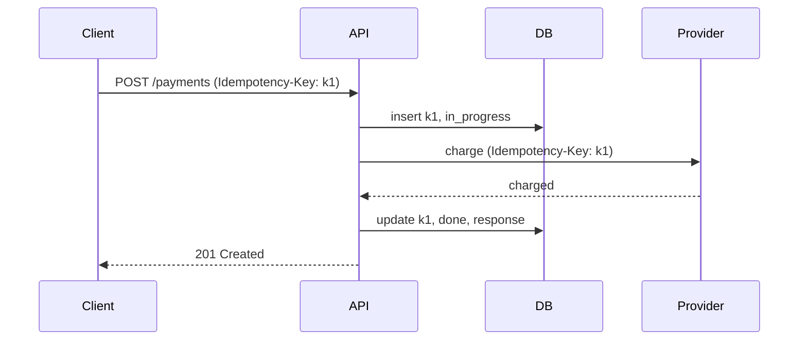

# Examples

Three rewrites of the methods and idempotency article, one for each part of the style: the opening, an option ladder, and the ending. They share one running example: a payment API whose clients retry after timeouts.

## Opening

Before. The definition comes first, and nothing tells the reader why it matters:

```markdown
An operation is idempotent when repeating it produces the same server state as
performing it once. Idempotency describes server-side effects. It does not
require the response body or status code to be identical on every call.
```

After. Situation, pain, idea, catch:

```markdown
Your checkout page sends a payment request. The network drops the response.
Did the charge go through? The client can't tell, so it retries, and the
customer may now have paid twice.

**Idempotency is what makes that retry safe.** An operation is idempotent if
running it twice leaves the server in the same state as running it once. The
response can differ: a second `DELETE` may return `404`. What matters is that
nothing new happened.

Some HTTP methods give you this for free. `POST` does not, and `POST` is where
the money moves. This article covers which methods are safe to retry, how to
make the others safe, and what interviewers ask about it.
```

What changed:

- The first paragraph is a situation the reader has been in, with a cost they care about.
- The definition arrives in the second paragraph, after the reader wants it, behind a bold thesis line.
- The third paragraph gives the catch (`POST`) and a one-sentence roadmap.

## Option ladder

A deep-dive section built as a ladder. Every rung has **How it works** and **Where it breaks**, and the section closes on what decides between them.

````markdown
## Stop a retried payment from charging twice

The client sends an `Idempotency-Key` header, a random ID it generates once per
payment and reuses on every retry. The question is what the server does with it.

### Naive approach: check, then charge

The first idea most people try is to look the key up before doing the work.

**How it works.**
1. Look up the key in the `idempotency_keys` table.
2. If it's there, return the stored response.
3. If not, charge the card, then save the key with the response.

**Where it breaks.** Two retries that arrive 10 ms apart both find no key, and
both charge the card. A crash between the charge and the save loses the record
entirely, so the next retry charges again. The check and the write are separate
steps, and anything can happen between them.

### Better approach: claim the key first

Make the database decide who goes first.

**How it works.**
1. Insert the key with status `in_progress`. A unique constraint on the key
   rejects the second insert.
2. The request that wins the insert charges the card.
3. It updates the row with status `done` and the response.
4. A request that loses the insert returns the stored response, or `409
   Conflict` while the first one is still running.

**Where it breaks.** If the process crashes after the charge but before step 3,
the row stays `in_progress` forever. The next retry can't tell whether the
customer was charged.

### Strong approach: pass the key all the way down

Here is the flow when the key travels with the request:



**How it works.** Claim the key as before, and forward the same key to the
payment provider. Stripe, for example, accepts an `Idempotency-Key` header and
returns the original result for a repeat. A stuck `in_progress` row is now safe
to retry, because the provider won't charge twice.

**Where it breaks.** The key has to be scoped to the caller and the endpoint,
or two customers who happen to pick the same key collide. A retry with the same
key and a different amount must be rejected, not replayed. The table also grows
forever unless keys expire after the retry window, usually 24 hours.

The naive approach is never enough for money. Choose between the other two on
one question: **does every system downstream of you also deduplicate?** If it
does, pass the key down. If it doesn't, you need a reconciliation job that
resolves stuck rows.
````

What to notice:

- The labels say where each rung sits before the reader reads it.
- The strongest rung still gets a **Where it breaks** paragraph.
- The diagram has a lead-in sentence and sits right where the flow is explained.
- The section ends on the one question that decides between the rungs, in bold.

## Ending

Before. The article stops on a list of links:

```markdown
See CRUD endpoints for the complete map and consistency for documenting these
choices.
```

After. The four-paragraph summary:

```markdown
## Summary

Idempotency is what lets a client retry without fear: the second attempt
changes nothing the first one didn't.

`GET`, `PUT`, and `DELETE` are idempotent by design. `POST` is not, so
operations that create something costly need an idempotency key that the server
claims before doing the work and stores with the result.

In an interview, bring this up whenever a design has payments, orders, or any
client that retries: name the key, say where it's stored, and say how long it
lives.

Don't treat "check, then write" as deduplication. Two retries can pass the
check together; only a unique constraint or an atomic claim stops them.
```

The links that used to end the article move into the body, next to the sentence that needs them, or into the pager at the bottom of the page.
