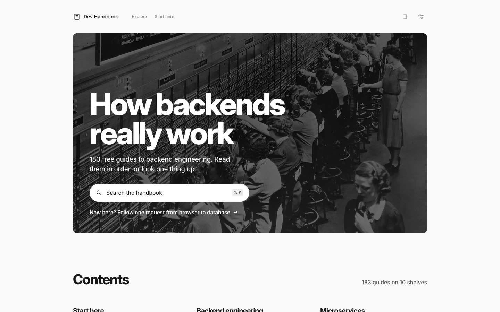
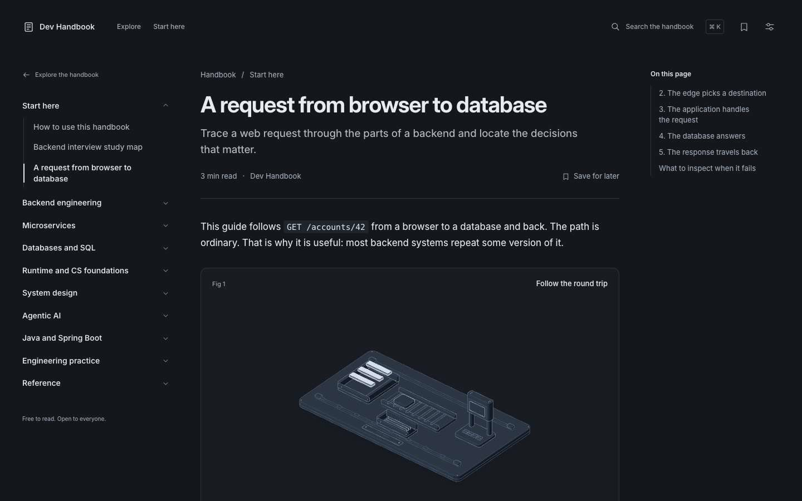

<div align="center">

# Dev Handbook

**How backends really work, explained one mechanism at a time.**

183 free guides to backend engineering, system design and agentic AI.<br>
No account, no paywall, no tracking. Read in order, or look one thing up.

[](LICENSE)
[](src/content/docs)
[](#how-it-is-built)
[](#deploy-it)
[](https://github.com/vasu2912/dev-handbook/stargazers)

<br>



</div>

<br>

## Why this exists

Most backend material is either a tutorial that stops at "hello world" or a reference that assumes you already know. Interview prep sits on top of both as a pile of flashcards.

This handbook takes the middle path. Each guide explains a mechanism: what happens, in what order, what it costs, and how it fails. The spine is a single request, `GET /accounts/42`, followed from the browser to the database and back. Every other guide hangs off one of its stops.

## What's inside

| Shelf                                                             | Guides | Covers                                                                                                                                      |
| ----------------------------------------------------------------- | -----: | ------------------------------------------------------------------------------------------------------------------------------------------- |
| [Start here](src/content/docs/guides/how-to-use-this-handbook.md) |      3 | How to use the handbook, a backend study map, and one request from browser to database                                                      |
| [Backend engineering](src/content/docs/backend/index.md)          |     30 | Architecture, API design, concurrency, security, HTTP, data and storage                                                                     |
| [Microservices](src/content/docs/microservices/index.md)          |     12 | Boundaries, gateways, circuit breakers, retries, sagas, outbox, Kafka, CQRS                                                                 |
| [Databases and SQL](src/content/docs/databases/index.md)          |      6 | Schema design, transactions and locking, indexes and query plans, migrations, caching                                                       |
| [Runtime and CS foundations](src/content/docs/runtime/index.md)   |      6 | Processes and I/O, memory, networking, data structures, algorithm patterns                                                                  |
| [System design](src/content/docs/system-design/index.md)          |     32 | Caching, load balancing, consistency, consensus, rate limiting, plus [worked designs](src/content/docs/system-design/walkthroughs/index.md) |
| [Agentic AI](src/content/docs/agentic-ai/index.md)                |     58 | LLM foundations, RAG, agents and tools, MCP, safety, production operation                                                                   |
| [Java and Spring Boot](src/content/docs/java-spring/index.md)     |     23 | Beans and proxies, JPA and transactions, HTTP clients, async jobs, testing                                                                  |
| [Engineering practice](src/content/docs/engineering/index.md)     |      9 | Object design, testing boundaries, containers, delivery, observability                                                                      |
| [Reference](src/content/docs/reference/http-status-codes.md)      |      4 | HTTP status codes, database indexes, a system design glossary, resources                                                                    |

New here? Read [A request from browser to database](src/content/docs/guides/request-lifecycle.md) first. It takes three minutes and gives you the map for everything else. Revising for interviews? Start with the [backend study map](src/content/docs/guides/backend-study-map.md) or the [Agentic AI learning paths](src/content/docs/agentic-ai/learning-paths.md).

## What reading it feels like



- **Figures you can work.** 131 isometric figures step through what a component does, and the [rate-limiting guide](src/content/docs/system-design/rate-limiting.md) has a live token bucket you can flood with requests.
- **Fast search.** Press <kbd>⌘</kbd> <kbd>K</kbd> anywhere. Search runs on a static [Pagefind](https://pagefind.app/) index, with no search service behind it.
- **Progress without an account.** Bookmark guides and mark them read. The landing page shows how far through each shelf you are. Everything stays in your browser's local storage.
- **Readable everywhere.** Light and dark themes, three text sizes, clean print styles. Every page is real HTML, so the guides read fine with JavaScript turned off.

## Run it locally

You need Node 24 or newer and pnpm. The `packageManager` field in `package.json` pins the pnpm version.

```sh
git clone https://github.com/vasu2912/dev-handbook.git
cd dev-handbook
pnpm install --frozen-lockfile
pnpm dev
```

Open `http://localhost:5173`. React and CSS changes hot reload. Markdown and navigation changes rebuild the content and reload the page. Set `PORT` to use another port.

Search uses the production index, so try it on a build:

```sh
pnpm build
pnpm preview
```

| Command        | What it does                                                                                            |
| -------------- | ------------------------------------------------------------------------------------------------------- |
| `pnpm dev`     | Starts the development server on localhost                                                              |
| `pnpm build`   | Compiles content, renders every page to HTML, and builds the search index into `dist/`                  |
| `pnpm preview` | Serves `dist/` locally                                                                                  |
| `pnpm test`    | Runs the figure tests                                                                                   |
| `pnpm check`   | Runs the tests, checks TypeScript, builds, and audits every page, internal link, anchor and local asset |

## How it is built

Every page is rendered to static HTML at build time. React then hydrates only the reader controls: search, bookmarks, appearance and the interactive figures. There is no server, database, or login.

```text
src/content/docs/*.md ──► scripts/content.mjs ──► React server render ──► dist/**/index.html
                          Markdown, Shiki,          src/App.tsx               + Pagefind index
                          Mermaid to SVG,
                          figures
```

```text
src/
  content/docs/      the guides, one Markdown file per route
  navigation.json    reading order and shelves
  components/        header, landing page, navigation, reading layout, search
  lib/               page validation (content.ts) and reader storage (reader.ts)
  figures/           browser code for the interactive figures
  styles/            layout, typography, diagrams, landing page
scripts/
  content.mjs        Markdown pipeline
  build.mjs          client build, server render, Pagefind
  dev.mjs            development server
  check-site.mjs     post-build audit of pages, links, anchors and assets
  figures/           build-time figure generators and the vendored Anatomy kit
research/            scope and source notes behind the guides
diagrams/            diagram sources
```

Stack: [React 19](https://react.dev/), [Vite](https://vite.dev/), TypeScript, [Radix](https://www.radix-ui.com/primitives) for dialogs and menus, [Pagefind](https://pagefind.app/) for search, [Shiki](https://shiki.style/) for code, and [Beautiful Mermaid](https://www.npmjs.com/package/beautiful-mermaid) for diagrams. Content parsers and diagram renderers never ship to the browser.

## Contributing

Corrections, new guides and better explanations are all welcome. Keep pull requests focused, say why the change helps a reader, and list the checks you ran.

Before you open a pull request, run:

```sh
pnpm check
```

If you change paths or deployment behaviour, also run `SITE_BASE=/dev-handbook/ pnpm check`. Run checks one at a time, because they share `.cache/` and `dist/`.

### Writing a guide

1. Add a Markdown file under `src/content/docs/`. The path is the route: `system-design/caching.md` becomes `/system-design/caching/`.
2. Give it frontmatter with a `title` and a `description`.
3. Add it to `src/navigation.json`, or put it in a directory covered by an `autogenerate` entry. The build fails if a guide cannot be reached from the navigation.
4. Follow the house style in [`.agents/skills/handbook-writing`](.agents/skills/handbook-writing/SKILL.md).

Keep existing routes and heading anchors stable. Other guides and outside sites link to them.

Some older guides use the chapter walkthroughs and connection-budget calculator in `src/styles/learning.css` and `public/js/site.js`. That script loads only on pages that contain them. Each example must stay readable without JavaScript and in print.

Markdown supports tables, fenced code, raw HTML, Mermaid fences, and Starlight-style callouts: `:::tip[Title]`, `:::note`, `:::caution` and `:::danger`. A Mermaid fence whose info string is `mermaid #fig-id Caption text.` becomes a numbered, captioned figure.

### Interactive figures

The rate-limiting guide embeds its figure with `<div data-figure="token-bucket"></div>`. `scripts/figures/token-bucket.mjs` draws the SVG at build time. `src/figures/token-bucket/model.ts` owns the credit accounting, and `live.ts` attaches the controls when the figure scrolls near. The figure pauses offscreen and in background tabs, and reduced motion keeps every control without animated traffic. Unknown figure names fail the build.

The isometric figures use the [Anatomy](scripts/figures/vendor/anatomy/README.md) drawing kit, vendored at the commit recorded in its README. Keep its MIT notice in that directory and in `public/licenses/anatomy.txt` when you update it, and keep the kit out of browser imports.

## Deploy it

The output in `dist/` is plain static files. Every route has its own `index.html`, and `404.html` handles missing pages, so deep links work on any static host without SPA rewrites.

**Cloudflare Pages** is the main target. Connect the repository through [Cloudflare's Git integration](https://developers.cloudflare.com/pages/configuration/git-integration/) with these settings:

- Production branch: `main`
- Build command: `pnpm check`
- Output directory: `dist`
- Node version: 24 or newer

Leave `SITE_BASE` unset for a root deployment. Set `SITE_URL` to your production origin, such as `https://your-site.pages.dev`, to get canonical URLs, Open Graph URLs and a sitemap.

**GitHub Pages** works through `.github/workflows/pages.yml`, which runs only when you trigger it by hand. In the repository settings, select **Pages → Build and deployment → GitHub Actions**, then open **Actions → Deploy handbook to GitHub Pages → Run workflow**. The workflow reads the base path from GitHub's Pages settings. To test a project path locally:

```sh
SITE_BASE=/dev-handbook/ pnpm build
SITE_BASE=/dev-handbook/ node scripts/check-site.mjs
SITE_BASE=/dev-handbook/ pnpm preview
```

Then open `http://localhost:4173/dev-handbook/`.

Both hosts are free on their provider subdomains. Nothing in the site calls a paid API.

## Credits

- Isometric figures drawn with the [Anatomy](scripts/figures/vendor/anatomy/README.md) kit, MIT licence.
- Landing page photograph: [Women working at a Bell System telephone switchboard](<https://commons.wikimedia.org/wiki/File:Photograph_of_Women_Working_at_a_Bell_System_Telephone_Switchboard_(3660047829).jpg>), U.S. National Archives, no known copyright restrictions.
- Search by [Pagefind](https://pagefind.app/), code highlighting by [Shiki](https://shiki.style/).

## Licence

[MIT](LICENSE) © 2026 Vasu Kandagatla. The licence covers the code and the guides. Third-party material keeps its own licence, as listed in [Credits](#credits).
