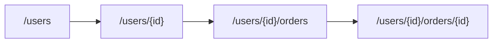

Roy Fielding described REST in his dissertation as an architectural style for networked systems. REST is short for Representational State Transfer. A resource has a representation, and the client and server transfer representations of its state under a set of constraints.

## The six constraints

| Constraint | Meaning | Why it helps |
| --- | --- | --- |
| Client-server | Keep the user interface and data storage concerns separate | Each side can evolve independently |
| Stateless | Each request carries the information needed to process it | Any server instance can handle the request |
| Cacheable | Responses state whether clients or intermediaries may reuse them | Caches reduce repeated work and latency |
| Uniform interface | Use resource identifiers, representations, self-descriptive messages, and predictable interactions | Clients learn one consistent interaction model |
| Layered system | A client need not know whether it talks to the origin server or an intermediary | Proxies, gateways, and caches can be inserted without changing clients |
| Code on demand, optional | A server may send executable code to extend a client | It adds flexibility but is not required for most HTTP APIs |

The constraints guide trade-offs. Statelessness makes horizontal scaling easier, but every request must carry or resolve its authentication context. Caching can lower load, but stale data becomes part of the contract. A uniform interface helps callers, but a resource model may not fit every operation.

## What REST does not require

Using JSON, plural nouns, or HTTP verbs does not by itself make an API RESTful. Those conventions are useful choices inside a resource-oriented HTTP interface. REST also does not mean every action must be forced into CRUD. A custom operation can have a clear resource and action design when it does not fit a state change on a resource.

## Richardson maturity model

| Level | Name | Description |
| --- | --- | --- |
| 0 | The swamp of POX | One endpoint and one method, often RPC-style POST calls |
| 1 | Resources | Separate endpoints identify different resources |
| 2 | HTTP verbs | Methods and status codes carry their intended semantics |
| 3 | Hypermedia, or HATEOAS | Responses include links that guide the client's next actions |

Most production HTTP APIs use Level 2 conventions. Level 3 can help clients discover workflows, but it adds design and client complexity. Choose it when links are part of the product's needs, not to satisfy a label.

Continue with [URL design](/backend/api-design/url-design/) and [HTTP and APIs](/backend/http-and-apis/).
