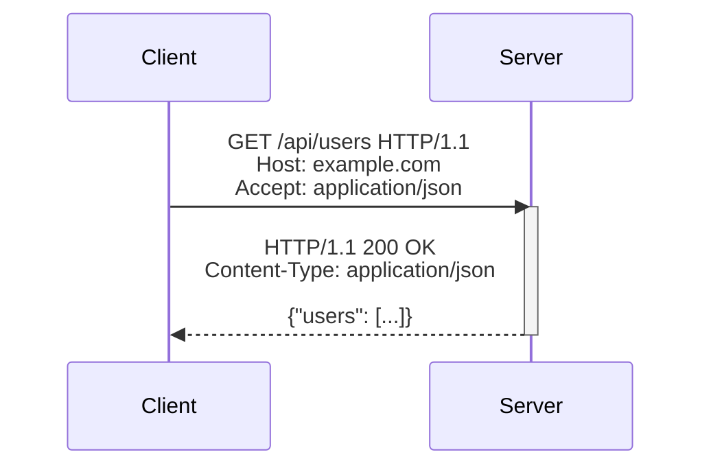

HTTP is a contract between a client and a server. The method says what kind of operation the client wants. The status code says how the server handled it. Headers carry metadata that changes how the request or response is interpreted.

For the full resource-oriented design model, continue with [API design](/backend/api-design/). Use [URL design](/backend/api-design/url-design/) for paths, [methods and idempotency](/backend/api-design/methods-and-idempotency/) for retries, and [CRUD endpoints](/backend/api-design/crud-endpoints/) for response status and body choices.





## Methods carry intent

`GET` reads a representation. `POST` asks the server to create a subordinate resource or perform an operation. `PUT` replaces a resource at a known location. `PATCH` applies a partial change. `DELETE` removes a resource.

Treat method semantics as part of the interface. A client may retry a `GET` after a network timeout because the method is safe. A `POST` needs an idempotency key or another design that makes a retry safe.

## Status codes carry outcome

Use the narrowest status that matches the result.

| Code | Meaning | Typical use |
| --- | --- | --- |
| `200 OK` | The request succeeded | Return a representation |
| `201 Created` | The server created a resource | Return the new resource and its location |
| `202 Accepted` | The server accepted work for later processing | Return a job or tracking URL |
| `204 No Content` | The request succeeded without a body | Complete a delete or update |
| `400 Bad Request` | The request is malformed | Reject invalid syntax or fields |
| `401 Unauthorized` | The caller is not authenticated | Ask for valid credentials |
| `403 Forbidden` | The caller is authenticated but cannot act | Reject a permission check |
| `404 Not Found` | The resource is unavailable at this location | Hide a missing or inaccessible resource |
| `409 Conflict` | The request conflicts with current state | Report a uniqueness or version conflict |
| `429 Too Many Requests` | The client exceeded a rate limit | Include a retry hint when known |
| `500 Internal Server Error` | The server failed unexpectedly | Log the cause and return a stable error shape |

## Make errors useful to clients

Return one error shape for the API. Include a stable code, a readable message, and a request ID. Do not return stack traces or database messages.

```json
{
	"code": "account_not_found",
	"message": "The account does not exist.",
	"requestId": "req_01J..."
}
```

The stable code is for programs. The message is for people. The request ID connects the response to server logs.

## Further reading

Continue with [the request lifecycle guide](/guides/request-lifecycle/) to see where an HTTP contract meets application and storage code. Then read [the backend request lifecycle](/backend/architecture/request-lifecycle/) for the internal handler, service, and repository path.
