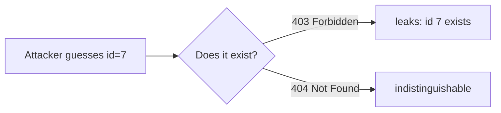
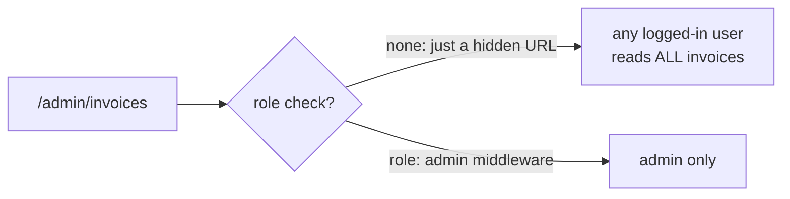

> Authentication answers *who are you?* Authorization answers *what are you allowed to do?* Most authorization bugs come from checking permission at the wrong layer.

## Authentication vs authorization

<svg role="img" aria-label="Authentication vs authorization distinction" viewBox="0 0 620 96" xmlns="http://www.w3.org/2000/svg" style="max-width:100%;height:auto;font-family:-apple-system,'Segoe UI',sans-serif">
  <defs>
    <marker id="az-arrow" markerWidth="10" markerHeight="10" refX="9" refY="3" orient="auto" markerUnits="strokeWidth">
      <path d="M0,0 L0,6 L9,3 z" fill="var(--diagram-muted)"/>
    </marker>
  </defs>
  <rect x="2" y="22" width="290" height="54" rx="8" fill="var(--diagram-accent-bg)" stroke="var(--diagram-accent)" stroke-width="1.5"/>
  <text x="147" y="44" text-anchor="middle" font-size="13" font-weight="700" fill="var(--diagram-ink)">Authentication</text>
  <text x="147" y="62" text-anchor="middle" font-size="11" fill="var(--diagram-muted)">which user?: proves identity</text>
  <rect x="328" y="22" width="290" height="54" rx="8" fill="var(--diagram-green-bg)" stroke="var(--diagram-green)" stroke-width="1.5"/>
  <text x="473" y="44" text-anchor="middle" font-size="13" font-weight="700" fill="var(--diagram-green)">Authorization</text>
  <text x="473" y="62" text-anchor="middle" font-size="11" fill="var(--diagram-green)">what can they do?: permissions</text>
  <line x1="292" y1="49" x2="326" y2="49" stroke="var(--diagram-muted)" stroke-width="1.5" marker-end="url(#az-arrow)"/>
</svg>

## The trap: a false sense of security

A typical backend stack: **routing → handlers → service → repository**. The usual mistake is to authenticate and authorize at the routing layer, then trust that the user can reach anything downstream.

<svg role="img" aria-label="Broken object level authorization where routing check passes but data layer lacks ownership filter" viewBox="0 0 640 300" xmlns="http://www.w3.org/2000/svg" style="max-width:100%;height:auto;font-family:-apple-system,'Segoe UI',sans-serif">
  <defs>
    <marker id="bola-arrow" markerWidth="10" markerHeight="10" refX="9" refY="3" orient="auto" markerUnits="strokeWidth">
      <path d="M0,0 L0,6 L9,3 z" fill="var(--diagram-muted)"/>
    </marker>
  </defs>
  <rect x="20" y="14" width="600" height="52" rx="8" fill="var(--diagram-green-bg)" stroke="var(--diagram-green)" stroke-width="1.5"/>
  <text x="320" y="36" text-anchor="middle" font-size="13" font-weight="700" fill="var(--diagram-green)">Routing layer: auth ✓ · permission read:books ✓</text>
  <text x="320" y="54" text-anchor="middle" font-size="11" fill="var(--diagram-green)">user is who they say, and can read books</text>
  <line x1="320" y1="66" x2="320" y2="82" stroke="var(--diagram-muted)" stroke-width="1.5" marker-end="url(#bola-arrow)"/>
  <rect x="20" y="84" width="600" height="52" rx="8" fill="var(--diagram-accent-bg)" stroke="var(--diagram-accent)" stroke-width="1.5"/>
  <text x="320" y="106" text-anchor="middle" font-size="13" font-weight="600" fill="var(--diagram-ink)">Service layer: fetch book with id = 5</text>
  <text x="320" y="124" text-anchor="middle" font-size="11" fill="var(--diagram-muted)">no check that book 5 belongs to this user</text>
  <line x1="320" y1="136" x2="320" y2="152" stroke="var(--diagram-muted)" stroke-width="1.5" marker-end="url(#bola-arrow)"/>
  <rect x="20" y="154" width="600" height="52" rx="8" fill="var(--diagram-red-bg)" stroke="var(--diagram-red)" stroke-width="2"/>
  <text x="320" y="176" text-anchor="middle" font-size="13" font-family="monospace" font-weight="700" fill="var(--diagram-red-text)">SELECT * FROM books WHERE id = 5</text>
  <text x="320" y="194" text-anchor="middle" font-size="11" fill="var(--diagram-red-text)">✗ missing: AND user_id = context.user_id</text>
  <line x1="320" y1="206" x2="320" y2="222" stroke="var(--diagram-muted)" stroke-width="1.5" marker-end="url(#bola-arrow)"/>
  <rect x="20" y="224" width="600" height="52" rx="8" fill="var(--diagram-red-bg)" stroke="var(--diagram-red)" stroke-width="2"/>
  <text x="320" y="246" text-anchor="middle" font-size="13" font-weight="700" fill="var(--diagram-red-text)">Attacker reads another user's book (or invoice)</text>
  <text x="320" y="264" text-anchor="middle" font-size="11" fill="var(--diagram-red-text)">just by changing ?id=5 to ?id=6, 7, 8…</text>
</svg>

Just because the user passed authentication and has the `read:books` permission does **not** mean they can access *every* book. The check must travel all the way to the data layer.

### BOLA: broken object level authorization

The scenario above has a name: **BOLA**. It means the system checks *which user* at the routing layer, but never checks *which object* at the data layer. An attacker writes a loop over IDs and downloads every invoice, every payment, every record.

**The fix: filter by owner at the point of access:**

```sql
-- wrong
SELECT * FROM invoices WHERE id = 7;

-- right
SELECT * FROM invoices WHERE id = 7 AND user_id = :context_user_id;
```

### Don't leak via error codes



If you fetch the row, then check ownership and return **403**, you've confirmed the object exists. An attacker enumerates IDs this way. Instead, do the ownership check **inside the query**: when no row matches, return **404**. Now an attacker can't tell "doesn't exist" from "exists but not yours".

### BFLA: broken function level authorization

BOLA is about *data*. **BFLA** is about *functions*: sensitive admin operations guarded only by a hidden URL ("security through obscurity").



An admin endpoint that lists *all* invoices can't use `AND user_id = …` (admins see everything). It needs a **role check** at the routing layer: is this user actually an admin?
### Indirect object references → use UUIDs

Sequential IDs (`1, 2, 3, …`) are predictable. An attacker who sees `/invoices/102` knows `101` and `103` exist, and can enumerate the whole table.

<svg role="img" aria-label="Predictable sequential IDs compared against unguessable UUIDs" viewBox="0 0 620 150" xmlns="http://www.w3.org/2000/svg" style="max-width:100%;height:auto;font-family:-apple-system,'Segoe UI',sans-serif">
  <rect x="2" y="20" width="300" height="110" rx="8" fill="var(--diagram-red-bg)" stroke="var(--diagram-red)" stroke-width="1.5"/>
  <text x="152" y="44" text-anchor="middle" font-size="13" font-weight="700" fill="var(--diagram-red-text)">Sequential ID</text>
  <text x="152" y="66" text-anchor="middle" font-size="12" font-family="monospace" fill="var(--diagram-red-text)">GET /invoices/102</text>
  <text x="152" y="86" text-anchor="middle" font-size="11" fill="var(--diagram-red-text)">guess 101, 103, 104…</text>
  <text x="152" y="104" text-anchor="middle" font-size="11" fill="var(--diagram-red-text)">✗ enumerable</text>
  <rect x="318" y="20" width="300" height="110" rx="8" fill="var(--diagram-green-bg)" stroke="var(--diagram-green)" stroke-width="1.5"/>
  <text x="468" y="44" text-anchor="middle" font-size="13" font-weight="700" fill="var(--diagram-green)">UUID</text>
  <text x="468" y="66" text-anchor="middle" font-size="12" font-family="monospace" fill="var(--diagram-green)">GET /invoices/9f8d-4c2e-…</text>
  <text x="468" y="86" text-anchor="middle" font-size="11" fill="var(--diagram-green)">random, unguessable</text>
  <text x="468" y="104" text-anchor="middle" font-size="11" fill="var(--diagram-green)">✓ can't enumerate</text>
</svg>

The fix: use a **UUID** (random, unguessable) as the primary key. It can't be enumerated. The trade-off: UUIDs index a little slower than sequential integers: worth reading up on, but for any externally-exposed ID they're the right default.

## Horizontal vs vertical: the mental model

Forget the acronym soup. Every authorization bug fits one of two shapes:

<svg role="img" aria-label="Horizontal vs vertical authorization attack vectors" viewBox="0 0 640 180" xmlns="http://www.w3.org/2000/svg" style="max-width:100%;height:auto;font-family:-apple-system,'Segoe UI',sans-serif">
  <defs>
    <marker id="hv-arrow" markerWidth="10" markerHeight="10" refX="9" refY="3" orient="auto" markerUnits="strokeWidth">
      <path d="M0,0 L0,6 L9,3 z" fill="var(--diagram-muted)"/>
    </marker>
  </defs>
  <rect x="2" y="20" width="300" height="120" rx="8" fill="var(--diagram-red-bg)" stroke="var(--diagram-red)" stroke-width="1.5"/>
  <text x="152" y="44" text-anchor="middle" font-size="13" font-weight="700" fill="var(--diagram-red-text)">Horizontal (BOLA / IDOR)</text>
  <text x="152" y="66" text-anchor="middle" font-size="11" fill="var(--diagram-muted)">User A → User B's data</text>
  <text x="152" y="84" text-anchor="middle" font-size="11" fill="var(--diagram-muted)">same privilege, wrong owner</text>
  <text x="152" y="118" text-anchor="middle" font-size="11" fill="var(--diagram-red-text)">fix: owner filter in the query</text>
  <rect x="338" y="20" width="300" height="120" rx="8" fill="var(--diagram-red-bg)" stroke="var(--diagram-red)" stroke-width="1.5"/>
  <text x="488" y="44" text-anchor="middle" font-size="13" font-weight="700" fill="var(--diagram-red-text)">Vertical (BFLA)</text>
  <text x="488" y="66" text-anchor="middle" font-size="11" fill="var(--diagram-muted)">Member → admin functions</text>
  <text x="488" y="84" text-anchor="middle" font-size="11" fill="var(--diagram-muted)">higher privilege, same user</text>
  <text x="488" y="118" text-anchor="middle" font-size="11" fill="var(--diagram-red-text)">fix: role check middleware</text>
  <line x1="302" y1="80" x2="336" y2="80" stroke="var(--diagram-muted)" stroke-width="1.5" marker-end="url(#hv-arrow)"/>
</svg>

## Four defenses

1. **Centralize authorization logic**: one layer every request passes through, not scattered checks that get forgotten.
2. **Default deny**: if your logic doesn't explicitly allow an action, deny it. New endpoints are protected by default.
3. **Test authorization specifically**: automated tests for "user A can't read user B" and "member can't reach admin", run in CI. Don't test only the happy path.
4. **Audit logs**: log every sensitive access and every failed authorization check, so you can detect and investigate probing.

Terms: [GLOSSARY](/reference/system-design-glossary/) · Next: [xss and csrf](/backend/security/xss-and-csrf/) · Up: [security mindset](/backend/security/)

