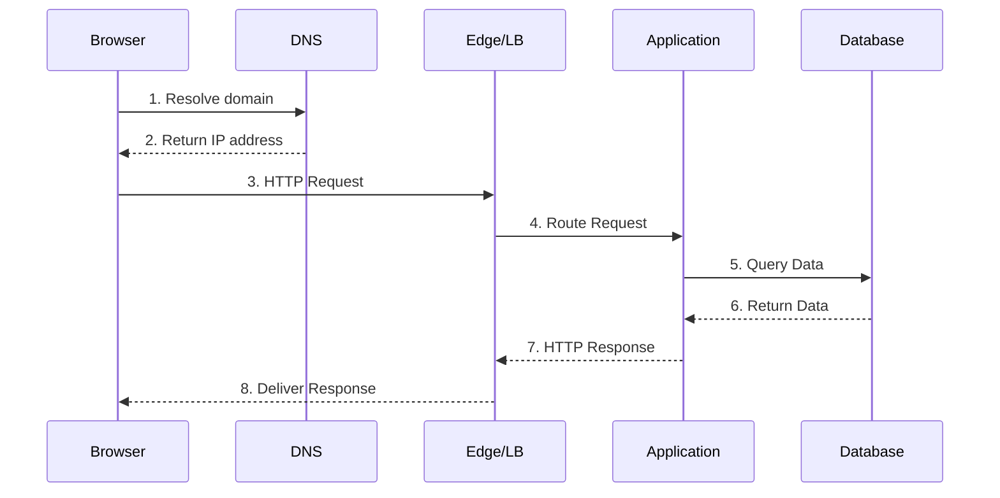

This guide follows `GET /accounts/42` from a browser to a database and back. The path is ordinary. That is why it is useful: most backend systems repeat some version of it.





## 1. The browser sends a request

The browser resolves the hostname, opens or reuses a connection, and sends an HTTP request.

```http
GET /accounts/42 HTTP/1.1
Host: example.test
Accept: application/json
```

The request carries method, path, headers, and sometimes a body. TLS encrypts the connection, but it does not decide whether the caller may read account `42`.

## 2. The edge picks a destination

A DNS record points the hostname at an edge service or load balancer. That service terminates TLS, applies coarse traffic rules, and forwards the request to an application instance.

The edge should not own account permissions. It does not have enough context to make that decision reliably.

## 3. The application handles the request

The application parses the route, authenticates the caller, checks authorization, and loads the account. Keep those steps distinct. A valid token proves identity. It does not prove access to every account.

The route handler owns HTTP input and output. Authentication and shared request data belong in [middleware](/backend/architecture/middleware/), while the use case belongs in a [service](/backend/architecture/services/). The [request lifecycle reference](/backend/architecture/request-lifecycle/) shows the complete flow.

```ts
const account = await accounts.findVisibleById({
	accountId: '42',
	viewerId: session.userId,
});
```

The [repository](/backend/architecture/repositories/) owns the query and its mapping to an `Account` record. The route handler decides how a missing record becomes an HTTP response. The [authorization guide](/backend/security/authorization/) explains why the query must include the caller's identity.

## 4. The database answers

The database checks its index, reads the matching row, and returns the selected columns. A query that returns one account should have a predictable plan and a limit of one.

If the query is slow, inspect the query plan and the index before adding a cache. A cache changes freshness and invalidation rules. It does not repair an unbounded query.

Use [databases](/system-design/databases/) for storage and query choices, [database indexes](/reference/database-indexes/) for lookup terms, and [caching](/system-design/caching/) when a cache is justified.

## 5. The response travels back

The application maps the record to a response shape and returns it through the edge.

```http
HTTP/1.1 200 OK
Content-Type: application/json

{"id":"42","name":"Ada Lovelace"}
```

The response status tells the client what happened. The body gives the client data. Logs and traces give operators the evidence to explain why it happened.

For response semantics, see [HTTP and APIs](/backend/http-and-apis/), [CRUD endpoints](/backend/api-design/crud-endpoints/), and the [HTTP status code reference](/reference/http-status-codes/).

## What to inspect when it fails

Start at the boundary where the symptom appears, then follow the request ID through each hop.

| Symptom | First place to inspect |
| --- | --- |
| DNS or connection error | DNS record, certificate, and edge health |
| `401 Unauthorized` | Authentication middleware and token expiry |
| `403 Forbidden` | Authorization rule and resource ownership |
| `404 Not Found` | Route match and query result |
| Slow response | Trace spans, database plan, and downstream calls |

The failure mode tells you which assumption to test. Keep the path visible in the code and in the telemetry.
