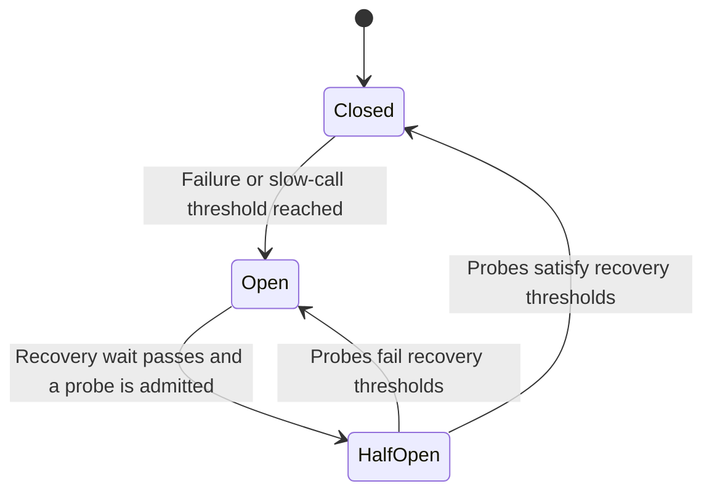

A circuit breaker temporarily stops calls to a dependency after observed failures cross a threshold. It protects the caller from repeatedly spending resources on work that is likely to fail and gives the dependency room to recover.

Suppose Payments normally responds in 100 ms but now takes five seconds. Checkout workers remain occupied while new requests arrive. A breaker can reject later calls promptly, but the calls already running still need timeouts.

## The state machine



| State     | Calls                                    | Purpose                                      |
| --------- | ---------------------------------------- | -------------------------------------------- |
| Closed    | Allowed and measured                     | Observe normal traffic                       |
| Open      | Rejected without invoking the dependency | Stop spending resources on likely failures   |
| Half-open | A limited number of probes allowed       | Check recovery without releasing all traffic |

An open breaker rejects a call before making the network request. In Resilience4j, the rejection is `CallNotPermittedException`. With the default transition behavior, a call after the wait triggers the move toward half-open. Automatic transition can be configured separately.

## Detection strategies and types

States describe lifecycle. Detection strategies describe how the breaker decides to open.

- A consecutive-failure strategy trips after an uninterrupted sequence of errors.
- A count-based window evaluates the last N completed calls.
- A time-based window evaluates calls recorded during a recent time interval.

Resilience4j supports count-based and time-based windows, with failure-rate and slow-call-rate thresholds. A minimum-call setting avoids drawing conclusions from a tiny sample. Its special operational states include disabled, forced-open, and metrics-only.

An application library can distinguish business errors from provider failures. A proxy or service mesh can apply protection outside the application, but its meaning of circuit breaking may emphasize connection and pending-request limits. Compare actual behavior before treating the settings as equivalent.

## A Java example

This example targets Java 21 and the Resilience4j 2.x core API. Add `io.github.resilience4j:resilience4j-circuitbreaker` using the compatible version selected by your application's dependency management. The example uses the programmatic API, so it does not require a Spring annotation or starter.

```java
import io.github.resilience4j.circuitbreaker.CircuitBreaker;
import io.github.resilience4j.circuitbreaker.CircuitBreakerConfig;
import java.io.IOException;
import java.net.URI;
import java.net.http.HttpClient;
import java.net.http.HttpRequest;
import java.net.http.HttpResponse;
import java.time.Duration;

public final class PaymentStatusClient {
	private final HttpClient http = HttpClient.newBuilder()
		.connectTimeout(Duration.ofMillis(300))
		.build();

	private final CircuitBreaker breaker = CircuitBreaker.of(
		"payment-status",
		CircuitBreakerConfig.custom()
			.slidingWindowType(CircuitBreakerConfig.SlidingWindowType.COUNT_BASED)
			.slidingWindowSize(20)
			.minimumNumberOfCalls(10)
			.failureRateThreshold(50)
			.slowCallDurationThreshold(Duration.ofMillis(500))
			.slowCallRateThreshold(50)
			.waitDurationInOpenState(Duration.ofSeconds(10))
			.permittedNumberOfCallsInHalfOpenState(3)
			.recordExceptions(IOException.class)
			.build());

	public int status(URI uri) throws Exception {
		try {
			return breaker.executeCallable(() -> {
				var request = HttpRequest.newBuilder(uri)
					.timeout(Duration.ofMillis(800))
					.GET()
					.build();
				var response = http.send(request, HttpResponse.BodyHandlers.discarding());
				if (response.statusCode() >= 500) {
					throw new IOException("Payment status provider failed");
				}
				return response.statusCode();
			});
		} catch (InterruptedException interrupted) {
			Thread.currentThread().interrupt();
			throw interrupted;
		}
	}
}
```

Reuse one client instance so calls share breaker history. Recreating it per request discards the observations. The URI represents a trusted configured provider endpoint, not a caller-controlled destination.

The numbers illustrate a policy, not production defaults. With ten recorded calls, five failures reach a 50% threshold. A response lasting 600 ms counts as slow even if it succeeds. The 800 ms request timeout bounds waiting independently of the slow-call measurement.

This client returns HTTP status codes for the caller to interpret. Here, 4xx responses do not count as provider failures. A production policy must decide how to handle 429, authentication failures, redirects, and provider-specific errors. A breaker cannot infer those meanings from an HTTP response unless the integration translates or classifies it.

## A Spring Boot example

In Spring Boot, configuration can supply the breaker policy while a Spring-managed service owns the HTTP call. This alternative targets the handbook's Java 21 and Spring Boot 4.0 baseline, using Spring Cloud CircuitBreaker with Resilience4j. The plain Java class above remains a separate implementation.

### Dependencies and version alignment

The following `pom.xml` fragment assumes an existing Boot 4.0 application with Boot dependency management. Spring Cloud's 2025.1 release train supports that baseline. The example selects 2025.1.3; check the [Spring Cloud compatibility table](https://spring.io/projects/spring-cloud/) when choosing versions for another application.

```xml
<dependencyManagement>
	<dependencies>
		<dependency>
			<groupId>org.springframework.cloud</groupId>
			<artifactId>spring-cloud-dependencies</artifactId>
			<version>2025.1.3</version>
			<type>pom</type>
			<scope>import</scope>
		</dependency>
	</dependencies>
</dependencyManagement>

<dependencies>
	<dependency>
		<groupId>org.springframework.cloud</groupId>
		<artifactId>spring-cloud-starter-circuitbreaker-resilience4j</artifactId>
	</dependency>
	<dependency>
		<groupId>org.springframework.boot</groupId>
		<artifactId>spring-boot-starter-restclient</artifactId>
	</dependency>
</dependencies>
```

The Cloud starter supplies the factory and Resilience4j integration. The REST client starter supplies Boot's configured `RestClient.Builder`. Their versions come from the respective dependency-management BOMs.

### The Spring service

Place this alternative `PaymentStatusClient` in a package scanned by the application's `@SpringBootApplication`. Its `status("p91")` method calls `GET /payments/p91/status` on the configured provider and returns a successful HTTP status code.

```java
import io.github.resilience4j.circuitbreaker.CallNotPermittedException;
import org.springframework.beans.factory.annotation.Value;
import org.springframework.cloud.circuitbreaker.resilience4j.Resilience4JCircuitBreakerFactory;
import org.springframework.cloud.client.circuitbreaker.CircuitBreaker;
import org.springframework.http.HttpStatus;
import org.springframework.stereotype.Service;
import org.springframework.web.client.HttpServerErrorException;
import org.springframework.web.client.ResourceAccessException;
import org.springframework.web.client.RestClient;
import org.springframework.web.server.ResponseStatusException;

@Service
public class PaymentStatusClient {
	private final RestClient http;
	private final CircuitBreaker breaker;

	public PaymentStatusClient(RestClient.Builder builder,
			Resilience4JCircuitBreakerFactory factory,
			@Value("${payments.base-url}") String baseUrl) {
		this.http = builder.baseUrl(baseUrl).build();
		this.breaker = factory.create("payment-status");
	}

	public int status(String paymentId) {
		return breaker.run(
			() -> http.get()
				.uri("/payments/{id}/status", paymentId)
				.retrieve()
				.toBodilessEntity()
				.getStatusCode().value(),
			this::unavailable);
	}

	private int unavailable(Throwable failure) {
		if (failure instanceof CallNotPermittedException
				|| failure instanceof ResourceAccessException
				|| failure instanceof HttpServerErrorException) {
			throw new ResponseStatusException(HttpStatus.SERVICE_UNAVAILABLE,
				"Payment status is temporarily unavailable", failure);
		}
		if (failure instanceof RuntimeException unexpected) {
			throw unexpected;
		}
		throw new IllegalStateException("Unexpected payment status failure", failure);
	}
}
```

`factory.create("payment-status")` selects the configuration with that exact instance name. Spring's default singleton service reuses the client and breaker across requests. The `CircuitBreaker` import here is Spring Cloud's interface; the factory supplies its Resilience4j implementation. The `run` call explicitly wraps the operation, so this version does not need an AOP annotation.

`retrieve()` turns provider error responses into exceptions. Connection and request-timeout failures become `ResourceAccessException`; provider 5xx responses become `HttpServerErrorException`. The recovery function maps those failures and open-circuit rejection to an unavailable outcome. An MVC endpoint calling this service can expose that outcome as HTTP 503. Other exceptions propagate for the application to handle through its error contract.

### application.properties

These settings belong in the Spring application's `src/main/resources/application.properties`:

```properties
# Replace this illustrative provider address for your environment.
payments.base-url=https://payments.example.com

# Boot-managed HTTP transport settings, shared by auto-configured clients.
spring.http.clients.imperative.factory=jdk
spring.http.clients.connect-timeout=300ms
spring.http.clients.read-timeout=800ms

# This synchronous example uses transport timeouts and an explicit breaker.
spring.cloud.circuitbreaker.resilience4j.disable-time-limiter=true
spring.cloud.circuitbreaker.bulkhead.resilience4j.enabled=false

# The instance name matches factory.create("payment-status").
resilience4j.circuitbreaker.instances.payment-status.sliding-window-type=COUNT_BASED
resilience4j.circuitbreaker.instances.payment-status.sliding-window-size=20
resilience4j.circuitbreaker.instances.payment-status.minimum-number-of-calls=10
resilience4j.circuitbreaker.instances.payment-status.failure-rate-threshold=50
resilience4j.circuitbreaker.instances.payment-status.slow-call-duration-threshold=500ms
resilience4j.circuitbreaker.instances.payment-status.slow-call-rate-threshold=50
resilience4j.circuitbreaker.instances.payment-status.wait-duration-in-open-state=10s
resilience4j.circuitbreaker.instances.payment-status.permitted-number-of-calls-in-half-open-state=3
resilience4j.circuitbreaker.instances.payment-status.automatic-transition-from-open-to-half-open-enabled=false
resilience4j.circuitbreaker.instances.payment-status.record-exceptions[0]=org.springframework.web.client.ResourceAccessException
resilience4j.circuitbreaker.instances.payment-status.record-exceptions[1]=org.springframework.web.client.HttpServerErrorException
resilience4j.circuitbreaker.instances.payment-status.ignore-exceptions[0]=org.springframework.web.client.HttpClientErrorException
```

### What the properties control

The breaker property names below share the prefix `resilience4j.circuitbreaker.instances.payment-status.`.

| Property                                              | Example value                       | Effect                                                                                                       |
| ----------------------------------------------------- | ----------------------------------- | ------------------------------------------------------------------------------------------------------------ |
| `sliding-window-type`                                 | `COUNT_BASED`                       | Evaluate a recent number of calls. `TIME_BASED` instead uses seconds for the window size.                    |
| `sliding-window-size`                                 | `20`                                | Keep outcomes from the last 20 recorded calls. This is not a concurrency limit.                              |
| `minimum-number-of-calls`                             | `10`                                | Wait for at least 10 recorded calls before evaluating the closed-state failure and slow-call rates.          |
| `failure-rate-threshold`                              | `50`                                | Open when at least half the evaluated calls failed.                                                          |
| `slow-call-duration-threshold`                        | `500ms`                             | Classify a completed call lasting longer than 500 ms as slow.                                                |
| `slow-call-rate-threshold`                            | `50`                                | Open when at least half the evaluated calls were slow, even if they succeeded.                               |
| `wait-duration-in-open-state`                         | `10s`                               | Keep rejecting calls for the recovery wait before allowing the transition toward probes.                     |
| `permitted-number-of-calls-in-half-open-state`        | `3`                                 | Admit up to three recovery probes before deciding whether to close or reopen.                                |
| `automatic-transition-from-open-to-half-open-enabled` | `false`                             | Let an incoming call after the wait trigger the transition. `true` enables a background transition.          |
| `record-exceptions`                                   | Transport and 5xx exception classes | Count these failures toward the threshold. Other exception types count as success unless explicitly ignored. |
| `ignore-exceptions`                                   | `HttpClientErrorException`          | Exclude 4xx errors from both failure and success counts. The exception still reaches the recovery function.  |

The Boot HTTP settings apply to auto-configured clients using the injected builder. With the selected JDK transport, connection timeout bounds establishing a new connection and read timeout uses the transport's request-timeout mechanism. They are not a deadline for the entire business operation. For provider-specific transport settings, use the [HTTP client configuration example](/java-spring/http-clients/#configure-once-call-through-an-adapter).

Spring Cloud's additional TimeLimiter is disabled here so transport timeout behavior is explicit. Its optional automatic bulkhead wrapping is also disabled. Those two settings affect the factory globally in this example. An application with several integrations needs policies appropriate to each one; [bulkheads](/microservices/bulkheads/) remain necessary when concurrency must be bounded.

### Following failure and recovery

Starting from an empty window, five transport or 5xx failures among ten recorded calls reach the 50% threshold and open the breaker. Subsequent calls invoke the recovery function without contacting Payments. After ten seconds, a new request triggers half-open and a limited set of probes determines recovery. Two failures among three probes exceed 50% and reopen the breaker.

A successful 600 ms response counts as slow. The 800 ms transport timeout remains a separate limit. A 4xx response is ignored by this breaker policy and propagates from the recovery function; ignoring an exception changes the statistics, not the caller's outcome. A real integration must decide whether statuses such as 429 deserve different treatment.

The recovery function runs on protected-call failures while closed as well as on open-circuit rejection. It never reports that a payment succeeded. These are illustrative settings and outcomes for understanding the policy, not measurements from a running Spring application.

## Composition and limitations

A breaker does not limit concurrency. Use a [bulkhead](/microservices/bulkheads/) for that. Its state is normally local to an application instance, so one instance may be open while another remains closed.

Decorator order matters. A breaker outside a retry observes the final logical outcome. A retry outside a breaker exposes each admitted attempt to the breaker. Retrying open-circuit rejections usually wastes time. Keep both within the request deadline.

Fallbacks must preserve meaning. A stale catalog price can be acceptable when labeled. A fabricated successful payment is not. Monitor transitions, rejected calls, latency, and traffic volume together. A low error rate caused by rejecting every request is not recovery.

## Sources

- [Resilience4j: CircuitBreaker](https://resilience4j.readme.io/docs/circuitbreaker)
- [Martin Fowler: Circuit Breaker](https://martinfowler.com/bliki/CircuitBreaker.html)
- [Java 21 HttpRequest.Builder timeout](<https://docs.oracle.com/en/java/javase/21/docs/api/java.net.http/java/net/http/HttpRequest.Builder.html#timeout(java.time.Duration)>)
- [Envoy: circuit breaking](https://www.envoyproxy.io/docs/envoy/latest/intro/arch_overview/upstream/circuit_breaking)
- [Spring Cloud: release-train compatibility](https://spring.io/projects/spring-cloud/)
- [Spring Cloud CircuitBreaker: starters](https://docs.spring.io/spring-cloud-circuitbreaker/reference/spring-cloud-circuitbreaker-resilience4j/starters.html)
- [Spring Cloud CircuitBreaker: properties and TimeLimiter configuration](https://docs.spring.io/spring-cloud-circuitbreaker/reference/spring-cloud-circuitbreaker-resilience4j/circuit-breaker-properties-configuration.html)
- [Spring Cloud CircuitBreaker: bulkhead wrapping](https://docs.spring.io/spring-cloud-circuitbreaker/reference/spring-cloud-circuitbreaker-resilience4j/bulkhead-pattern-supporting.html)
- [Spring Boot 4.0: REST clients and transport properties](https://docs.spring.io/spring-boot/4.0/reference/io/rest-client.html)
