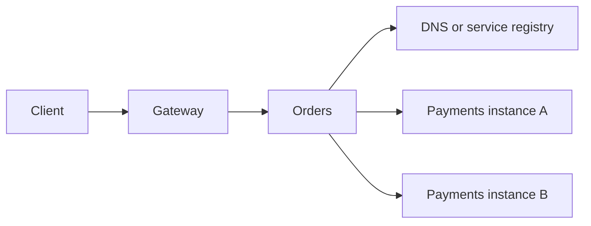

Service discovery maps a logical service name to available instances. An API gateway handles an application's external entry points. A load balancer selects an instance. One product can perform several roles, but the responsibilities remain distinct.

## Following one request

With client-side discovery, the caller resolves instances and selects one. With server-side discovery, a proxy or platform resolves and routes for the caller. DNS caching, readiness, connection reuse, and stale registry entries affect how quickly routing adapts to an instance disappearing.

In Kubernetes, a Service gives a stable destination while the set of ready Pods changes. Existing connections and endpoint updates still have timing behavior. Discovery does not make every selected instance infallible.

## Gateway and mesh roles

A gateway can terminate TLS, route public paths, apply authentication, limit traffic, and aggregate responses. A backend for frontend tailors responses to one client experience. Business authorization still belongs with the service that owns the resource.

A service mesh manages service-to-service traffic through infrastructure proxies or related data-plane components. It can supply mutual TLS, telemetry, and routing policies. It cannot decide whether a timed-out business operation is safe to repeat. Multiple retry layers can amplify traffic.

## Communication choices

| Approach          | Useful when                                             | Main consideration                                      |
| ----------------- | ------------------------------------------------------- | ------------------------------------------------------- |
| HTTP resource API | Clients need widely understood resource operations      | Contracts, status semantics, and compatibility          |
| gRPC              | Typed service calls or streaming fit the system         | Generated contracts, deadlines, and operational support |
| Messaging         | Work can finish later or multiple consumers need events | Delivery, ordering, duplicates, and lag                 |

gRPC supports unary, server-streaming, client-streaming, and bidirectional-streaming calls. Generated types do not remove partial failure. A message broker removes the immediate response requirement but introduces an observable pending state.

Read [HTTP and APIs](/backend/http-and-apis/), [message brokers](/microservices/message-brokers/), and [timeouts](/microservices/timeouts-and-retries/) for the mechanics behind these choices.

## Sources

- [Kubernetes: Service](https://kubernetes.io/docs/concepts/services-networking/service/)
- [gRPC: core concepts](https://grpc.io/docs/what-is-grpc/core-concepts/)
- [Microsoft: Gateway Routing pattern](https://learn.microsoft.com/en-us/azure/architecture/patterns/gateway-routing)
