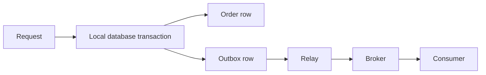

The dual-write problem appears when one operation must update a database and publish a message. Either ordering has a crash window. Committing first can lose publication. Publishing first can announce a database change that never commits.

## Transactional outbox

Write the business change and an outbox row in the same local transaction. A relay publishes committed outbox rows and records completion after broker confirmation.

If the process stops before commit, neither row becomes committed. If it stops after commit, the relay can resume. If publication succeeds but recording completion fails, the relay publishes again. The outbox prevents lost intent, but consumers still need to handle duplicates.

Relays commonly poll pending rows or use change data capture from the database log. Polling requires efficient queries and coordinated claims. CDC requires connector operation, log retention, and recovery planning.

## Delivery guarantees

| Guarantee                              | Consequence                                                                        |
| -------------------------------------- | ---------------------------------------------------------------------------------- |
| At most once                           | Work can be lost, but the delivery mechanism avoids retries that create duplicates |
| At least once                          | Work is retried, so duplicate delivery must be safe                                |
| Exactly once within a defined boundary | Coordinated state changes avoid duplicate committed effects inside that boundary   |

Exactly-once broker processing does not automatically cover a payment provider or unrelated database. Always identify which effects participate in the guarantee.

## A transactional consumer

Give each event a stable identifier. In one transaction, insert that identifier into a table with a unique constraint and apply the business change. A repeated event finds the identifier and skips the already committed effect. A failed transaction rolls both changes back.

Acknowledging before commit risks loss. Acknowledging after commit permits redelivery after a crash, which the identifier handles. The deduplication record must live long enough to cover the permitted replay period.

Ordering needs a separate policy. An event ID prevents repeats; an aggregate version detects a stale or missing update. Retry queues can reorder events, and poison messages need inspection and repair.

See the [Spring outbox and consumer examples](/java-spring/events-messaging/) for SQL and Java behavior.

## Sources

- [AWS: transactional outbox pattern](https://docs.aws.amazon.com/prescriptive-guidance/latest/cloud-design-patterns/transactional-outbox.html)
- [Apache Kafka: delivery semantics](https://kafka.apache.org/41/design/design/)
